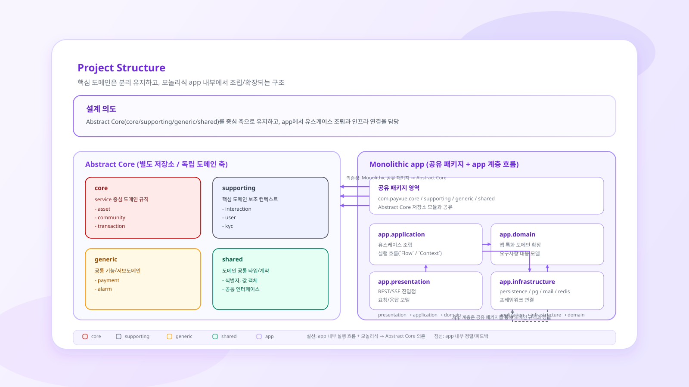
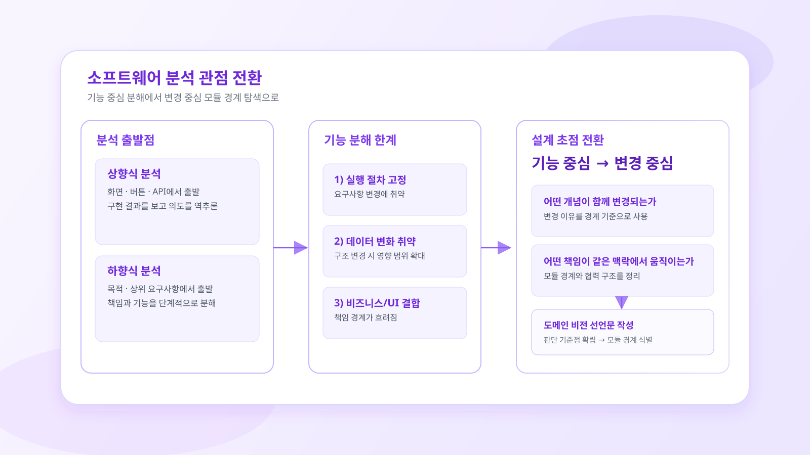
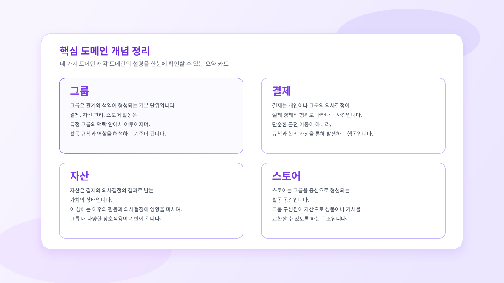
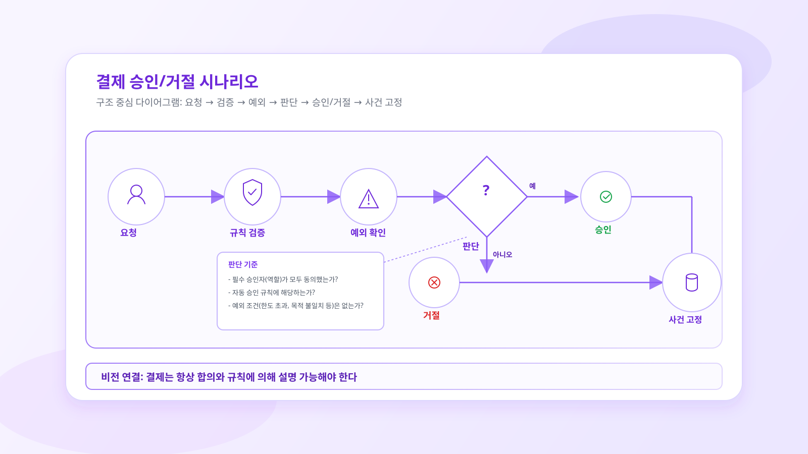
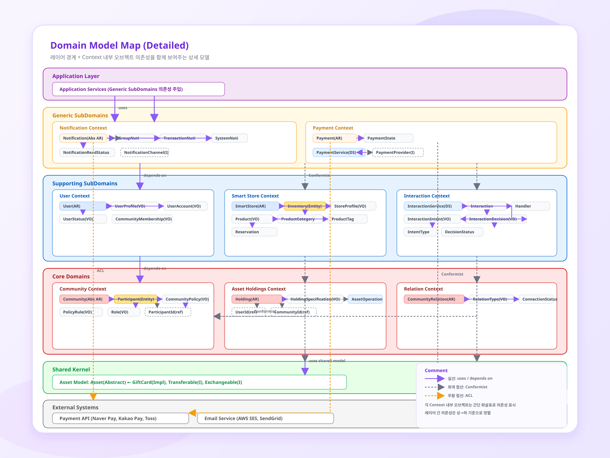

# payvue-core

Payvue의 핵심 도메인 개념과 규칙을 애플리케이션 구현으로부터 분리해 관리하는 멀티 모듈 저장소입니다.

이 저장소는 화면, API 엔드포인트, 프레임워크 설정처럼 애플리케이션마다 달라지는 실행 로직보다 **커뮤니티·자산·관계·거래가 무엇이며 어떤 규칙을 지켜야 하는지**를 코드로 표현하는 데 초점을 둡니다. 애플리케이션은 이 모델과 계약을 가져와 유스케이스를 조립하고, 영속성이나 외부 서비스 연동은 경계 밖의 어댑터로 연결합니다.

> 현재 버전: `0.0.1-SNAPSHOT` · Java 21 · Kotlin 1.9.23 · Gradle 8.11

## 프로젝트 경계



`payvue-core`는 위 그림의 **Abstract Core**에 해당합니다. 핵심 모델을 별도 저장소에 두어 애플리케이션의 배포 주기, 전달 방식, 프레임워크 선택과 독립적으로 발전시키는 것이 이 경계의 목적입니다.

| `payvue-core`가 소유하는 것 | 애플리케이션이 소유하는 것 |
| --- | --- |
| 애그리게이트, 엔티티, 값 객체 | Controller, API 요청/응답 모델 |
| 불변식, 정책, 명세, 상태 전이 | 유스케이스 순서와 트랜잭션 경계 |
| Repository·Gateway 등 외부 연결 계약 | Repository·Gateway의 기술 구현 |
| 컨텍스트를 구성하는 도메인 수준의 타입 | 인증, 영속성, 메시징, 외부 API 설정 |

실제 모듈 의존성은 각 모듈의 `build.gradle`에 명시합니다.

## 도메인 모델링

### 1. 기능이 아니라 변경의 이유로 경계를 찾습니다



화면이나 API를 기준으로 기능을 잘게 나누면 실행 절차가 구조를 지배하기 쉽습니다. Payvue는 **무엇이 함께 변경되는지**, **어떤 책임이 같은 언어와 규칙을 공유하는지**를 먼저 살피고 모듈 경계를 정합니다.

### 2. 서비스의 핵심 개념을 먼저 식별합니다



Payvue가 다루는 세계는 개인과 그룹의 관계 안에서 결제와 자산의 변화가 일어나고, 그 판단과 결과를 설명할 수 있어야 한다는 관점에서 출발합니다. 초기 모델링에서 찾은 그룹, 결제, 자산, 스토어는 이후 코드에서 다음과 같이 구체화되었습니다.

- 그룹은 `Community`와 `Participant`가 담당합니다.
- 자산은 `Holdings`와 `AssetItem`, 자산 특성(`AssetCharacteristic`)으로 표현합니다.
- 그룹 간 연결은 `CommunityRelation`, 자산의 이동 기록은 `Transaction`으로 분리합니다.
- 결제와 스토어는 각각 `payment`, `smartstore` 컨텍스트에서 핵심 모델을 보조합니다.

### 3. 시나리오에서 책임과 불변식을 도출합니다



예를 들어 그룹원의 결제 요청은 단순한 CRUD가 아니라 요청, 규칙 검증, 예외 확인, 승인 또는 거절, 결과 기록의 흐름입니다. 이 시나리오는 다음 모델의 책임으로 이어집니다.

- `Community`는 최소 한 명의 참여자와 결정권자가 있어야 한다는 불변식을 지킵니다.
- `Holdings`는 자신이 관리하는 자산의 소유 커뮤니티가 일치하는지 검증합니다.
- `Interaction`은 `Intent`와 `Decision`을 연결해 참여자 사이의 판단 흐름을 표현합니다.
- `Transaction`은 행위자, 출발·도착 커뮤니티, 자산, 실행 상태와 메타데이터를 함께 기록합니다.

### 4. 핵심·지원·일반 하위 도메인을 구분합니다



이 그림은 기술 계층을 위아래로 쌓은 아키텍처가 아니라, 도메인 디스틸레이션으로 찾아낸 모델의 중요도와 각 컨텍스트의 협력 관계를 함께 보여주는 컨텍스트 맵입니다. 모든 모델을 같은 중요도로 다루지 않고, **Payvue만의 규칙을 만드는가**, **핵심 규칙을 수행하는 데 필요한가**, **외부 서비스와 무관하게 일반화할 수 있는가**, **여러 컨텍스트가 같은 의미로 공유해야 하는가**를 기준으로 Core, Supporting, Generic, Shared를 구분했습니다.

#### 분류에 도달한 과정

1. **서비스 시나리오를 찾습니다.** 개인이나 그룹이 자산을 보유하고, 커뮤니티 간 관계를 정의하고, 결제를 요청하거나 자산를 이동시키는 요구사항을 파악했습니다.
3. **핵심 도메인을 파악합니다.** `Community`, `Holdings`, `CommunityRelation`, `Transaction`이 각각 독립적인 일관성 경계를 갖게 되었습니다.
4. **지원 도메인을 파악합니다.** 사용자 정보, 커뮤니티 간 상호작용 실행은 핵심 모델을 가능하게 하지만 각자의 변경 이유를 가지므로 Supporting Domain으로 분리했습니다.
5. **일반 하위 도메인을 파악합니다.** 결제 제공자와 알림 채널은 Payvue의 차별화된 규칙이라기보다 교체 가능한 기능이므로 Generic Subdomain의 계약과 실행 컨텍스트로 모델링했습니다.
6. **공유되는 타입이 필요한지 파악합니다.** 금액과 자산 특성, 애그리게이트 및 상태 계약처럼 여러 컨텍스트에서 의미가 변하지 않는 타입만 Shared 영역에 둡니다.

#### Core Domain: 서비스의 중심 규칙

Core Domain은 그룹 안에서 누가 어떤 자산을 가지고, 어떤 관계와 판단을 통해 자산이 이동했는지를 설명합니다. 현재 소스에서는 네 개의 경계로 구체화되어 있습니다.

| 모듈 | 모델링 질문 | 애그리게이트와 규칙 |
| --- | --- | --- |
| `community` | 누가 같은 집단에 속하고 누가 관리자인가? | 추상 애그리게이트 `Community`가 `Participant`와 `RoleDescriptor`를 소유합니다. 커뮤니티에는 한 명 이상의 참여자와 결정권자가 있어야 하며, `CommunityCapability`는 구성원 추가·삭제·역할 변경 시 `CommunityPolicy`를 받는 확장 계약을 정의합니다. |
| `asset-holdings` | 어떤 커뮤니티가 어떤 자산을 보유하고 무엇을 할 수 있는가? | `Holdings`가 한 `CommunityId`의 자산 컬렉션을 일관성 경계로 묶습니다. 모든 `AssetItem`의 소유 커뮤니티가 일치해야 하며, `HoldingSpecification` 조합으로 대상을 찾고 `AssetOperationUnit`으로 행위를 분리합니다. |
| `relation` | 두 커뮤니티가 어떤 관계를 맺을 수 있고 그 관계는 어떻게 변하는가? | `CommunityRelation`은 출발·도착 커뮤니티의 타입 조합으로 `RelationType`을 결정합니다. 자기 자신과의 관계나 타입에 맞지 않는 관계를 거부하고, `PENDING`, `ACTIVE`, `SUSPENDED`, `TERMINATED` 상태 사이에서 허용된 전이만 수행합니다. |
| `transaction` | 자산의 이동을 어떤 사실과 정책으로 기록할 것인가? | `TransactionCommand`가 자산, 금액, 행위자, 출발·도착 커뮤니티와 메타데이터를 한 요청으로 묶고 `Transaction`으로 고정합니다. `TransactionBindingRegistry`는 자산 종류와 거래 유형에 맞는 핸들러를 선택하고, 정책과 데코레이터가 필요한 규칙을 확장합니다. |

이 경계들은 서로 복사된 데이터를 소유하기보다 필요한 모델이나 식별자를 통해 협력합니다. 예를 들어 `Holdings`는 커뮤니티 전체가 아니라 `CommunityId`를 소유하고, `AssetItem`은 소유 커뮤니티와 기여자 식별자를 가집니다. 반면 `CommunityRelation`과 `Transaction`은 현재 `Community` 객체를 직접 참조합니다. 이는 모든 경계가 최종 형태로 고정된 것이 아니라, 모델을 사용하면서 참조 범위와 계약을 계속 정제하는 **발전하는 질서**의 단계에 있음을 보여줍니다.

#### Supporting Domain: 핵심 모델을 완성하는 문맥

Supporting Domain은 Payvue의 중심 규칙 그 자체는 아니지만, 핵심 시나리오가 실제로 동작하려면 필요한 모델입니다. Core Domain 안에 편의상 합치지 않고 별도 문맥으로 두어 각자의 언어와 변경 주기를 보존합니다.

| 모듈 | 핵심 모델을 지원하는 방식 | 주요 모델링 결과 |
| --- | --- | --- |
| `user` | 커뮤니티 참여자와 거래 행위자를 식별하고 사용자 생애주기를 제공합니다. | `User`가 프로필, 계정, 자격 증명, 상태, 멤버십과 환경 설정을 묶고, `UserKyc`가 본인 확인 상태를 별도 규칙으로 관리합니다. 조회와 명령 컨텍스트를 나누어 사용자 구성 정책을 조립합니다. |
| `interaction` | 한 사용자의 의도가 다른 참여자의 판단을 거쳐 실행되는 과정을 표현합니다. | `Intent`와 `Decision`을 입력으로 받아 `InteractionContext`에서 검증하고, 이를 지원하는 `DomainService`와 `InteractionHandler`가 `Interaction`의 완료 또는 실패 상태를 만듭니다. 결제 요청 승인 같은 교차 컨텍스트 시나리오의 연결점입니다. |
| `smartstore` | 커뮤니티가 상품과 재고를 운영하고 가치 교환을 반복할 수 있게 합니다. | `SmartStore`가 프로필과 상태를 관리하고, `Inventory`가 상품 수량과 `ProductReservation`의 생성·확정·취소를 책임집니다. 스토어 운영 규칙을 커뮤니티나 거래 애그리게이트에 섞지 않습니다. |

#### Generic Subdomain: 교체 가능한 기능과 외부 연동

Generic Subdomain은 서비스에 필요하지만 Payvue만의 문제는 아닌 기능입니다. 내부 도메인 언어가 결제 사업자나 전달 채널의 모델에 오염되지 않도록 포트와 번역 경계를 먼저 정의합니다.

| 모듈 | 변화 요인 | 모델링 방식 |
| --- | --- | --- |
| `payment` | 단건·가상계좌 같은 결제 방식과 외부 제공자별 API가 달라집니다. | `PaymentMode`가 결제 모드를, `PaymentGateway`가 외부 호출 계약을, `PaymentTranslator`가 외부 응답의 번역을 담당합니다. `PaymentCommandDispatcher`와 `PaymentContext`가 이들을 조립하고 `Payment` 상태로 결과를 고정합니다. |
| `alarm` | 이메일·푸시 등 채널과 실패 처리 방식이 달라집니다. | `Alarm`은 수신자와 내용을 표현하고, `ChannelRouter`와 `AlarmChannel`이 전달 경로를 선택합니다. `AlarmContext`는 저장소, 채널, 예외 처리기를 조합해 전달 기술의 차이를 캡슐화합니다. |

#### Shared: 최소한의 공통 언어

Shared 영역은 중복 제거를 위한 잡다한 유틸리티 모음이 아닙니다. `shared:common`은 `AggregateRoot`, `DomainEvent`, 식별 계약과 실행·참여 상태처럼 도메인 모델이 공통으로 사용하는 기반을 제공하고, `shared:asset`은 `Money`와 `AssetCharacteristic`, `Acquirable`, `Consumable`, `HasBalance`, `Ownable`처럼 자산을 설명하는 공통 언어를 제공합니다. 공유 타입이 커질수록 컨텍스트가 함께 변경되어야 하므로, 의미가 안정적이고 실제로 공동 소유해야 하는 타입만 이 경계에 둡니다.

다이어그램은 모델링 당시의 설계 스냅샷이고, 저장소는 그 모델이 구현과 검증한 현재 상태입니다. 그림의 `Notification Context`는 현재 `alarm` 모듈로 표현되고, `Holding`은 `asset-holdings`의 `Holdings`로 구체화되었습니다. 현재 코드에는 그림보다 구체적인 `transaction` Core Domain이 존재하며, 그림의 `Transferable`·`Exchangeable` 중심 자산 특성은 현재 `Acquirable`·`Consumable`·`HasBalance`·`Ownable` 계약으로 정리되어 있습니다. 따라서 그림은 경계와 협력의 설계 의도를 설명하고, 아래 모듈 목록과 실제 소스는 현재 구현을 설명하는 기준으로 함께 읽어야 합니다.

## 모듈 구성

```text
payvue-core
├── core-domain
│   ├── community
│   ├── asset-holdings
│   ├── relation
│   └── transaction
├── supporting-domain
│   ├── user
│   ├── interaction
│   └── smartstore
├── generic-sub-domain
│   ├── payment
│   └── alarm
└── shared
    ├── common
    └── asset
```

| 분류 | 모듈 | 책임 |
| --- | --- | --- |
| Core | `community` | 커뮤니티, 참여자, 역할, 정책과 컨텍스트 구성 |
| Core | `asset-holdings` | 커뮤니티 소유 자산, 보유 명세, 자산 특성과 수행 능력 |
| Core | `relation` | 커뮤니티 간 관계 유형과 연결 상태 |
| Core | `transaction` | 자산 이동 명령, 처리 정책, 바인딩과 거래 기록 |
| Supporting | `user` | 사용자·계정·프로필·멤버십·KYC와 사용자 컨텍스트 |
| Supporting | `interaction` | 의도, 판단, 승인과 상호작용 실행 흐름 |
| Supporting | `smartstore` | 스토어, 상품, 재고와 예약 |
| Generic | `payment` | 결제 모드, 명령, Gateway, 번역기와 실행 컨텍스트 |
| Generic | `alarm` | 알림, 수신자, 채널 라우팅과 실패 처리 |
| Shared | `common` | 애그리게이트 루트, 도메인 이벤트, 공통 상태와 기간 타입 |
| Shared | `asset` | `Money`와 재사용 가능한 자산 특성 계약 |

## 시작하기

### 요구 사항

- JDK 21
- 별도의 Gradle 설치는 필요하지 않습니다. 저장소의 Gradle Wrapper를 사용합니다.

### 빌드와 테스트

```bash
./gradlew build
./gradlew test
```

테스트 프로필은 `domain`, `fast`, `ci`, `all` 중 하나를 선택할 수 있습니다. 기본값은 `domain`입니다.

```bash
./gradlew test -Ptest.profile=fast
./gradlew test -Ptest.profile=ci
./gradlew test -Ptest.profile=all
```

특정 모듈만 검증할 수도 있습니다.

```bash
./gradlew :core-domain:community:test
./gradlew :generic-sub-domain:payment:test
```

## 설계 자료 출처

이 문서의 다이어그램은 [`payvue/front-react-core`](https://github.com/payvue/front-react-core)의 블로그 `[설계] Core`, `[구현] DDD`에서 사용한 원본 SVG를 가져와 README 문맥에 맞게 배치했습니다. 가져온 기준 리비전은 [`e6b1803`](https://github.com/payvue/front-react-core/commit/e6b1803deeb42900a868a9c63f4fc5639014f0d5)입니다.

다이어그램은 설계 의도와 모델링 과정을 설명하는 자료이며, 현재 코드 구조에 대한 최종 기준은 이 저장소의 소스와 Gradle 설정입니다.
